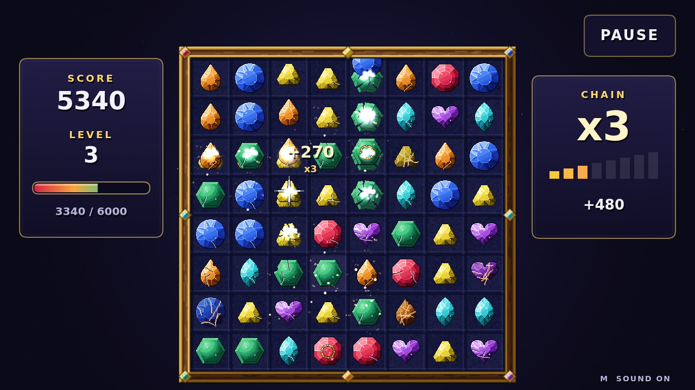

# Facet

Facet is a match game of cut stones on a lamp-lit jeweller's bench. Seven kinds
of gem fill an eight-by-eight board — ruby, amber, citrine, jade, beryl,
sapphire, and amethyst, each with its own colour and its own cut. Take hold of a
gem, carry it onto the gem beside it, and let go: if the trade lines up three or
more of one kind, they shatter, the stones above tumble into the gap, and fresh
stones drop in from the top. A move that would shatter nothing simply doesn't
take.

What makes Facet different is strain. Every clear presses on the stones around
it, and each knock shows: a first hairline crack, then a spreading fracture,
then a stone cracked right through and glowing at the seams. That last one is
flawed. A flawed gem shatters with any clear that touches it and is worth
double — and when flawed stones sit side by side, one clear sets off the next
like a fuse. Wear a corner of the board down and a single swap beside it can
run into a long, roaring chain, every step worth more than the one before.

Bigger lines leave something behind. Four in a row cuts a brilliant, set in a
gold ring, which takes the ring of gems around it when it goes. Two lines
crossing cut a star, which sweeps its whole row and column. Five or more cut a
prism, a rainbow stone of no kind at all: trade it with any gem and every gem of
that kind on the board shatters at once.

Each level asks for more points than the last, and the round runs until the
board holds no move that would shatter anything. Play it with a mouse, a pen, or
a fingertip.
